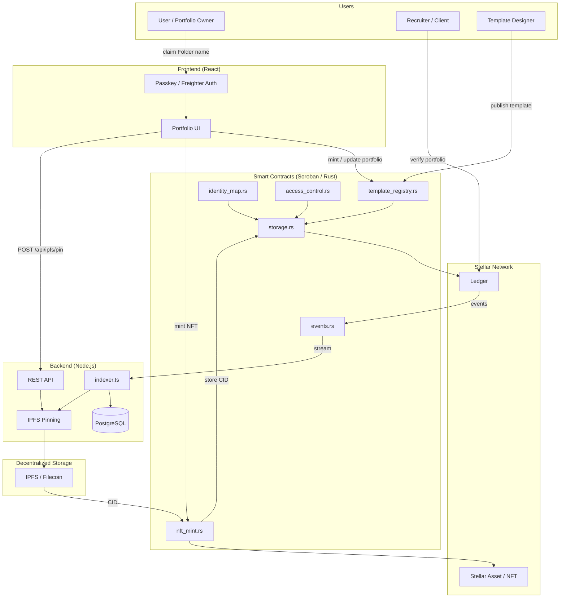

# Indexer-Contract

[](https://github.com/Haroldwonder/Indexer-Contract/actions/workflows/contract-ci.yml)

Soroban smart contracts (Rust) powering the **Folder** ecosystem. Manages the on-chain template registry, user identity mapping, and portfolio NFT minting on the Stellar network.

## Overview

Folder is a dynamic on-chain identity platform that lets users create, own, and share verifiable portfolio NFTs on Stellar. Each "Folder" is a Non-Fungible Token whose metadata points to decentralized storage (IPFS), making portfolios portable, tamper-proof, and globally accessible at a fraction of a cent per transaction.

## Organisation

This contract is one of three repositories in the Folder organisation.

| Repo | Purpose | Language |
|---|---|---|
| `Indexer-Contract` | Soroban smart contracts — identity, templates, NFT minting | Rust |
| `Indexer-Frontend` | User-facing portfolio UI and passkey auth | TypeScript / React |
| `Indexer-Backend` | Off-chain indexer, API, IPFS pinning, event listener | TypeScript / Node.js |

### Repository Integration Map

The Folder product is split across three repositories that must stay aligned:

| Repository | Responsibility | Primary consumers |
|---|---|---|
| `Indexer-Contract` | Soroban smart contract for Folder identity, template registry, portfolio NFT state, events, and admin controls. | Frontend, backend indexer, deployment automation |
| `Indexer-Frontend` | User interface for claiming Folder names, selecting templates, authenticating users, and minting/updating portfolios. | End users, wallet/passkey flows |
| `Indexer-Backend` | Off-chain indexer/API layer for Soroban events, IPFS pinning, cached portfolio/template data, and frontend API responses. | Frontend, ops, analytics |

Cross-repo contract points:

- Contract function names and argument order must match frontend contract clients.
- Contract events must match backend event indexer subscriptions.
- Contract error codes must match frontend/backend user-facing error handling.
- Validation limits should be mirrored client-side before submitting transactions.
- `CONTRACT_ID`, Stellar network, and RPC URL must be coordinated across all repos after every deployment.

When changing this contract:

1. Update `Indexer-Frontend` contract call wrappers and validation.
2. Update `Indexer-Backend` event parsing, API schemas, and validation.
3. Update deployment environment values after redeploy.
4. Update this repository's README, events, errors, and validation docs.

## Domain Vocabulary

These terms are consistent across all three repos.

| Term | Definition |
|---|---|
| **Folder** | A user's on-chain portfolio identity — one per Stellar address |
| **Folder Name** | A unique human-readable handle (e.g. `alice.folder`) claimed on-chain |
| **Template** | A numbered layout (1–N) stored in the contract; maps to a visual design in the frontend |
| **Portfolio NFT** | The on-chain record linking an owner, template, and IPFS CID |
| **IPFS CID** | Content Identifier — the hash of portfolio data stored on IPFS, anchored on-chain |
| **Admin** | A Stellar address with elevated contract permissions |

## Features

- **Folder Identity**: One `.folder` name per owner address, with reverse lookup from owner to Folder name
- **Template Registry**: Admin-managed mapping of non-zero Template IDs to IPFS metadata URIs
- **Portfolio Records**: One portfolio record per owner, linking owner, selected template, IPFS CID, and mint timestamp
- **Access Control**: Owner-only writes for user state and admin-only writes for template/admin management
- **Input Validation**: Folder names, IPFS CIDs, metadata URIs, and template IDs are validated before storage
- **IPFS Anchoring**: Portfolio/template metadata is stored off-chain; current CID/URI references are anchored on-chain
- **Typed Event Emission**: Soroban `#[contractevent]` events support off-chain indexing and frontend reactivity

Ecosystem-level features such as passkey onboarding, IPFS pinning, and proof-of-work enrichment are handled by the frontend/backend repos and must integrate with this contract surface.

## Architecture



### Core Contract Modules

| File | Responsibility |
|---|---|
| `src/lib.rs` | Public contract entry point — all exposed functions |
| `src/types.rs` | `PortfolioNFT`, `Template`, `DataKey` enum |
| `src/errors.rs` | `ContractError` enum |
| `src/storage.rs` | All ledger reads/writes with TTL management |
| `src/access_control.rs` | `require_admin`, `require_owner`, admin CRUD |
| `src/identity_map.rs` | Folder name claiming and resolution |
| `src/template_registry.rs` | Template registration, listing, user assignment |
| `src/nft_mint.rs` | Portfolio NFT minting, updating, verification |
| `src/events.rs` | Event emission for all state changes |
| `src/test.rs` | 43-case test suite |

### Storage Model

- **Instance Storage**: initialization flag, admin list, template definitions, and template ID list — shared contract-wide state
- **Persistent Storage**: user identity mappings, selected templates, and portfolio records — per-user data with ~1 year TTL bump on access

## Contract Functions

### Identity & Onboarding

- `claim_folder(owner, folder_name)` — Claim a unique Folder name (owner auth required; must be done before minting)
- `get_folder(folder_name)` → `Address` — Resolve a Folder name to its owner
- `get_identity(owner)` → `String` — Get the Folder name for an address

### Template Registry

- `register_template(admin, template_id, metadata_uri)` — Add a new non-zero template ID (admin only; no duplicate IDs)
- `get_template(template_id)` → `Template` — Fetch template metadata
- `list_templates()` → `Vec<u32>` — All available Template IDs
- `set_user_template(owner, template_id)` — Assign a template to a claimed Folder (owner auth required)
- `get_user_template(owner)` → `Option<u32>` — Get the template currently assigned to a Folder

### Portfolio NFT

- `mint_portfolio(owner, template_id, ipfs_cid)` — Mint a portfolio NFT (owner must have a Folder name; one mint per address)
- `update_portfolio(owner, ipfs_cid)` — Update the IPFS CID (owner auth required)
- `get_portfolio(owner)` → `PortfolioNFT` — Retrieve portfolio details
- `verify_portfolio(owner)` → `bool` — Public read — `true` when a portfolio exists, `false` otherwise

### Admin

- `initialize(admin)` — One-time contract setup
- `add_admin(admin, new_admin)` — Grant admin role
- `remove_admin(admin, target)` — Revoke admin role (cannot remove last admin)

## Frontend Integration

The frontend calls the contract via `@stellar/stellar-sdk` / Soroban RPC. All write functions require the caller to sign with their Stellar keypair or SEP-20 passkey — never handle raw secret keys in the frontend.

### Events the Frontend Listens For

| Symbol | Payload | Action |
|---|---|---|
| `folder_cl` | `(owner, folder_name)` | Update claimed-name UI state |
| `port_mint` | `(owner, template_id, ipfs_cid)` | Show new portfolio card |
| `port_upd` | `(owner, ipfs_cid)` | Refresh portfolio display |
| `tmpl_reg` | `(template_id, metadata_uri)` | Add template to picker |
| `tmpl_set` | `(owner, template_id)` | Highlight active template |

> Event symbols are max 9 characters — Soroban `symbol_short!` limit.

## Backend Integration

The backend indexes contract events via Soroban RPC event streaming (entry point: `src/indexer.ts`).

### Events → Backend Actions

| Symbol | Backend Action |
|---|---|
| `folder_cl` | Upsert identity record in DB |
| `port_mint` | Pin IPFS CID, store NFT record |
| `port_upd` | Re-pin new CID, update NFT record |
| `tmpl_reg` | Cache template metadata |
| `tmpl_set` | Update user-template mapping |

### Backend API Endpoints

```
GET  /api/folder/:folder_name   → owner address + portfolio
GET  /api/portfolio/:owner      → full portfolio (contract + IPFS merged)
GET  /api/templates             → all templates with metadata
GET  /api/identity/:owner       → folder name for an address
POST /api/ipfs/pin              → pin portfolio JSON, returns CID
```

### IPFS Flow

```
1. Frontend  →  POST /api/ipfs/pin  (portfolio JSON)
2. Backend   →  pins to IPFS, returns CID
3. Frontend  →  mint_portfolio(owner, template_id, CID)  on contract
4. Contract  →  emits port_mint event
5. Backend   →  indexes event, stores CID reference in DB
```

> IPFS pinning always happens **before** the contract transaction, not after.

## Shared Data Structures

```ts
// TypeScript — Frontend & Backend
interface PortfolioNFT {
  owner: string;        // Stellar address (G...)
  template_id: number;
  ipfs_cid: string;     // e.g. "bafybeig..."
  minted_at: number;    // Unix timestamp (ledger)
}

interface Template {
  template_id: number;
  metadata_uri: string; // IPFS URI pointing to template JSON
  creator: string;      // Stellar address
}
```

```rust
// Rust — src/types.rs
pub struct PortfolioNFT { pub owner, pub template_id, pub ipfs_cid, pub minted_at }
pub struct Template     { pub template_id, pub metadata_uri, pub creator }
```

## Security Features

See [Security Notes](docs/SECURITY.md) for authorization and state invariants.

1. **Owner-Only Writes**: User state mutations require the owner's Stellar signature
2. **Folder-First User Actions**: A Folder name must be claimed before portfolio minting or template selection
3. **No Double-Mint**: A second `mint_portfolio` call returns `PortfolioAlreadyMinted`; use `update_portfolio`
4. **Public Verification**: Anyone can read and verify portfolio authenticity without permission
5. **Auditable CID Updates**: CID changes require owner authorization and emit update events
6. **Admin Role Guards**: Template registration and admin management are gated behind admin authorization
7. **Storage Invariants**: Duplicate template IDs, duplicate Folder claims, and template ID `0` are rejected
8. **TTL Management**: Persistent storage entries are bumped ~1 year on access to prevent expiry

## Why Stellar

| Property | Detail |
|---|---|
| Transaction cost | ~$0.00001 — accessible to job seekers in any economy |
| Finality | ~5 seconds — portfolio updates are live globally almost immediately |
| Interoperability | Stellar payment history (USDC, fiat anchors) can be surfaced as Proof of Work |
| Passkeys (SEP-20) | Biometric onboarding — no 24-word seed phrases for non-crypto users |

## Roadmap

| Phase | Status | Goal | Contract scope | Cross-repo dependencies |
|---|---|---|---|---|
| Phase 1 | Implemented in contract | Folder identity | `initialize`, admin controls, one Folder claim per owner, Folder lookup, validation, events | Frontend wallet/passkey UX and backend identity indexing |
| Phase 2 | Implemented in contract foundation | Template registry | non-zero template IDs, duplicate rejection, template metadata URI anchoring, user template selection for claimed Folders | Frontend template picker and backend template cache |
| Phase 3 | Implemented in contract foundation | Portfolio records | one mint per owner, owner-only CID updates, template requirement, public verification, TTL bumps, events | Backend IPFS pinning/indexing and frontend portfolio rendering |
| Phase 4 | Next | Production deployment | verified optimized WASM, deployed `CONTRACT_ID`, network-specific env values | Stellar CLI install, funded deployer, frontend/backend env rollout |
| Phase 5 | Next | Stronger verification | full CID parsing, optional credential linkage primitives, cross-repo event compatibility tests | Backend credential/indexing services and frontend verification UI |
| Phase 6 | Future | Marketplace | designer ownership/payment mechanics and template sale flows | Marketplace UI, payment/indexing backend, economic policy |

## Quick Start

### 1. Build the Contract

```bash
cargo build --target wasm32v1-none --release
stellar contract optimize --wasm target/wasm32v1-none/release/indexer_contract.wasm
```

Soroban SDK 25 uses `wasm32v1-none` for modern Rust toolchains. The target is declared in `rust-toolchain.toml`.

### 2. Deploy to Testnet

```bash
stellar contract deploy \
  --wasm target/wasm32v1-none/release/indexer_contract.optimized.wasm \
  --source deployer \
  --network testnet
```

### 3. Initialize

```bash
stellar contract invoke \
  --id <CONTRACT_ID> \
  --source deployer \
  --network testnet \
  -- initialize \
  --admin <ADMIN_ADDRESS>
```

### 4. Claim a Folder

```bash
stellar contract invoke \
  --id <CONTRACT_ID> \
  --source <USER_KEYPAIR> \
  --network testnet \
  -- claim_folder \
  --owner <USER_ADDRESS> \
  --folder_name "jane.folder"
```

### 5. Mint a Portfolio NFT

```bash
stellar contract invoke \
  --id <CONTRACT_ID> \
  --source <USER_KEYPAIR> \
  --network testnet \
  -- mint_portfolio \
  --owner <USER_ADDRESS> \
  --template_id 1 \
  --ipfs_cid "bafybeig..."
```

## Environment Variables

### This repo (deploy scripts)

```env
STELLAR_NETWORK=testnet
STELLAR_RPC_URL=https://soroban-testnet.stellar.org
DEPLOYER_SECRET=S...
ADMIN_ADDRESS=G...
CONTRACT_ID=C...
```

### Indexer-Backend

```env
CONTRACT_ID=C...
STELLAR_RPC_URL=https://soroban-testnet.stellar.org
STELLAR_NETWORK=testnet
IPFS_API_URL=https://api.pinata.cloud
IPFS_API_KEY=...
DATABASE_URL=postgresql://...
```

### Indexer-Frontend

```env
NEXT_PUBLIC_CONTRACT_ID=C...
NEXT_PUBLIC_STELLAR_NETWORK=testnet
NEXT_PUBLIC_BACKEND_URL=https://api.folder.xyz
```

## Testing

```bash
make check
cargo test --locked
```

Use `make check` for the full local gate. Use `cargo test --locked` when you only need the contract test suite.

## Local Quality Gates

Run the same checks locally before opening a PR:

```bash
make check
```

This runs formatting, `cargo check`, clippy with warnings denied, the unit test suite, the release WASM build, and shell-script syntax validation.

Tests cover:
- ✅ Contract initialization and double-init rejection
- ✅ Folder name claiming and collision prevention
- ✅ Mint rejected without a claimed Folder name
- ✅ Template registration, retrieval, duplicate rejection, and non-zero template IDs
- ✅ Portfolio NFT minting and CID anchoring
- ✅ Double-mint rejection
- ✅ Portfolio update authorization
- ✅ Public verification reads
- ✅ Admin role management
- ✅ Unauthorized access rejection
- ✅ User template assignment, retrieval, Folder-first enforcement, and unknown-template rejection
- ✅ Folder/CID/metadata validation bounds and format rules
- ✅ Missing read paths and exact contract errors

## Error Codes

See [Error Reference](docs/ERRORS.md) for compatibility rules when adding or handling errors.

Input validation limits are documented in [Validation Policy](docs/VALIDATION.md).

Deployment handoffs should follow the [Release Checklist](docs/RELEASE_CHECKLIST.md).

| Code | Error | Description | Frontend / Backend Handling |
|---|---|---|---|
| 1 | AlreadyInitialized | Contract already initialized | Ignore on deploy retry |
| 2 | NotInitialized | Contract not yet initialized | Block all UI until admin calls `initialize` |
| 3 | FolderNameTaken | Folder name already claimed | Show "name unavailable" in claim form |
| 4 | FolderNotFound | Folder name does not exist | Show 404 portfolio page |
| 5 | PortfolioNotFound | No portfolio minted for this address | Show "no portfolio yet" CTA |
| 6 | TemplateNotFound | Template ID does not exist | Remove stale template from picker |
| 7 | Unauthorized | Caller is not the owner or admin | Show auth error, prompt re-sign |
| 8 | InvalidCID | IPFS CID is empty or malformed | Reject upload before submitting tx |
| 9 | InvalidFolderName | Folder name is empty or invalid | Validate client-side before tx |
| 10 | AdminAlreadyExists | Admin address already registered | Suppress duplicate admin UI action |
| 11 | AdminNotFound | Admin address not found | Show "admin not found" in admin panel |
| 12 | CannotRemoveLastAdmin | Cannot remove the last remaining admin | Disable remove button when only 1 admin |
| 13 | PortfolioAlreadyMinted | Portfolio already minted | Direct user to `update_portfolio` |
| 14 | InvalidMetadataURI | Template metadata URI is empty, malformed, or too long | Reject template registration before tx |
| 15 | TemplateAlreadyExists | Template ID already registered | Ask admin to choose a new template ID |
| 16 | FolderAlreadyClaimed | Address already owns a Folder name | Show existing Folder and disable new claim |
| 17 | InvalidTemplateID | Template ID is invalid | Use a positive non-zero template ID |

## Events

Typed event definitions and indexer-facing schema are documented in [Contract Events](docs/EVENTS.md).

| Symbol | Emitted When | Payload |
|---|---|---|
| `folder_cl` | A user claims a Folder name | `(owner, folder_name)` |
| `port_mint` | A new portfolio NFT is minted | `(owner, template_id, ipfs_cid)` |
| `port_upd` | A portfolio's IPFS CID is updated | `(owner, ipfs_cid)` |
| `tmpl_reg` | A new template is added to the registry | `(template_id, metadata_uri)` |
| `tmpl_set` | A user selects a template for their Folder | `(owner, template_id)` |

## Cross-Repo Change Checklist

When a contract function signature changes:
- [ ] Update `src/lib.rs` in `Indexer-Contract`
- [ ] Update `src/lib/contract.ts` in `Indexer-Frontend`
- [ ] Update API handler + indexer in `Indexer-Backend`
- [ ] Update the function table and data structures in this README

When a new event is added:
- [ ] Add emission in `src/events.rs`
- [ ] Add to frontend event listener
- [ ] Add to backend indexer
- [ ] Update the events table in this README

## Dependencies

- `soroban-sdk = "=25.3.1"`

## License

MIT

## Contributing

Contributions are welcome!

See [Development Workflow](docs/DEVELOPMENT.md) for local tooling and quality gates.

Quick checklist:
- All checks pass: `make check`
- New features include tests
- Documentation is updated
- Contract function changes are reflected in all three repos (see checklist above)

## Support

- GitHub Issues: [Create an issue](https://github.com/Haroldwonder/Indexer-Contract/issues)
- Stellar Discord: https://discord.gg/stellar
